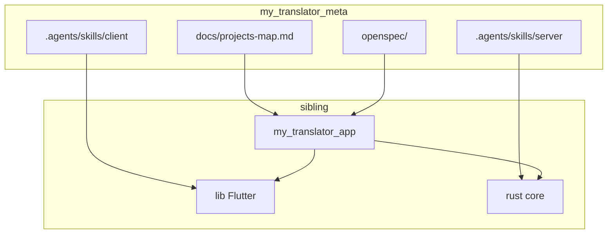

# Projects map — My Translator

Канон соответствия пакетов экосистемы **My Translator** (продукт: **Translation Reader**) путям в workspace разработчика. Исходный код **не** хранится в `my_translator_meta` — клонируется рядом (sibling `my_translator_app`). Локальные отклонения путей — в [`projects-map.local.yaml`](../projects-map.local.yaml) (см. ниже).

См. также: [README.md](README.md) (оглавление docs), пакетный [`../my_translator_app/AGENTS.md`](../my_translator_app/AGENTS.md).

## Layout workspace

```
<workspace>/                          # напр. my_translate (не git)
├── my_translator_meta/               # этот репозиторий: docs, OpenSpec, AI skills
└── my_translator_app/                # Flutter UI + Rust core + FRB (один runtime-репо)
```

Пути в таблицах ниже — **относительно корня `my_translator_meta`**, по умолчанию `../my_translator_app/...`.

## App (Flutter + Rust)

| Сервис | Роль | Git-репозиторий | Путь исходников | Документация / контекст |
|--------|------|-----------------|-----------------|-------------------------|
| **App** | Flutter UI (`lib/`) + Rust core (`rust/`) + FRB | `my_translator_app` | `../my_translator_app/` | runtime: `../my_translator_app/AGENTS.md`; skills: `.agents/skills/client/` и `.agents/skills/server/` в meta |

Runtime-код и пакетный `AGENTS.md` живут **в sibling**. Client/server skills и OpenSpec — в **my_translator_meta**. Skills с префиксом `server/` относятся к **Rust-ядру внутри того же app** (in-process FRB).

## Локальный `projects-map.local.yaml`

У каждого разработчика свой файл в корне `my_translator_meta` (в git **не** коммитится). Шаблон: [`projects-map.local.yaml.example`](../projects-map.local.yaml.example).

Ключи совпадают с таблицей «Пути для OpenSpec / агентов». Значения — относительные (от корня `my_translator_meta`) или абсолютные пути.

```yaml
app: ../my_translator_app
```

**Resolution из корня `my_translator_meta`**

1. Прочитать канон (этот файл).
2. Если существует `projects-map.local.yaml` — смержить: local **перекрывает** канон по ключу.
3. Относительные пути резолвить от корня `my_translator_meta`; проверить, что корень существует (например `{app}/pubspec.yaml` или `{app}/rust/Cargo.toml`).
4. Если путь не найден — **спросить у пользователя**, не угадывать.

## Child `project-map.md`

В корне sibling `my_translator_app` — `project-map.md` с ключом **`my_translator_meta`** (относительный путь к этому метарепозиторию).

| Расположение клона | Значение `my_translator_meta` (default sibling layout) |
|--------------------|--------------------------------------------------------|
| `<workspace>/my_translator_app/` рядом с `my_translator_meta` | `..` |

Пример (в корне app):

```markdown
| Key | Relative path |
|-----|---------------|
| my_translator_meta | .. |
```

**Resolution из sibling-репо**

1. Прочитать локальный `project-map.md`, ключ `my_translator_meta`.
2. Корень валиден, если существует `{my_translator_meta}/docs/projects-map.md`.
3. Далее — канон + опциональный `{my_translator_meta}/projects-map.local.yaml`.
4. Если не найдено — спросить абсолютный путь к `my_translator_meta`.
5. Ссылки в child markdown на канон: `my_translator_meta/docs/...` (не `../../docs/...`).

## Пути для OpenSpec / агентов

Канон путей к исходникам **от корня `my_translator_meta`**. Перед доступом читать эту таблицу (+ local YAML). OpenSpec: [openspec/config.yaml](../openspec/config.yaml) (`projectsMap` → этот файл).

| Ключ | Путь (от корня my_translator_meta) | Назначение |
|------|-------------------------------------|------------|
| `meta` | `.` | OpenSpec, skills, docs |
| `app` | `../my_translator_app/` | Flutter + Rust + FRB (Translation Reader) |
| `app.agents` | `../my_translator_app/AGENTS.md` | продукт / стек / домены |
| `app.lib` | `../my_translator_app/lib/` | Flutter UI |
| `app.data` | `../my_translator_app/lib/data/` | Drift user persist + offline translate facade (`data/translate/`) + video extract (`data/video/`) |
| `app.data.translate` | `../my_translator_app/lib/data/translate/` | Dart facade: native FRB ORT \| Web Transformers.js |
| `app.data.video` | `../my_translator_app/lib/data/video/` | Reader video pick/path/extract facade (FFmpegKit native \| web canvas; no Rust video API) |
| `app.assets.opus` | `../my_translator_app/assets/models/opus-mt-en-ru/` | OPUS-MT EN→RU ONNX + tokenizer |
| `app.rust` | `../my_translator_app/rust/` | Rust crate (`rust_lib_my_translator_app`) |
| `app.rust.tokenize` | `../my_translator_app/rust/src/tokenize/` | panko tokenize (char spans) |
| `app.rust.lemmatize` | `../my_translator_app/rust/src/lemmatize/` | EN WordNet morph keys |
| `app.rust.translate` | `../my_translator_app/rust/src/translate/` | native ORT offline MT (не wasm32) |
| `app.rust.api` | `../my_translator_app/rust/src/api/` | публичный FRB API (источник правды FFI) |
| `app.rust.generated` | `../my_translator_app/lib/src/rust/` | GENERATED Dart bindings (не править вручную) |
| `app.frb` | `../my_translator_app/flutter_rust_bridge.yaml` | конфиг codegen |
| `app.web.translate` | `../my_translator_app/web/` | `translate_bridge.js` / `translate_worker.js` / `transformers/` |
| `app.tests` | `../my_translator_app/test/` | Flutter unit/widget tests |
| `app.integration_test` | `../my_translator_app/integration_test/` | Flutter integration tests |
| `app.rust.tests` | `../my_translator_app/rust/` | `cargo test` (unit рядом с модулями) |

Команды из каталога пакета (ключ `app`):

- Flutter: `flutter pub get`, `flutter analyze`, `flutter test`, `flutter run`, `flutter build apk|ipa|web`
- Web run (канон): `flutter run -d chrome --web-port=5555` + COOP/COEP — skill `work-with-env-deploy` (порт входит в origin Drift)
- Rust: `cargo check`, `cargo test` в `{app}/rust/`
- FRB: `flutter_rust_bridge_codegen generate` (CLI ≈ 2.13); после API — `build-web`

Команды запускает **агент** из каталога sibling-репо. Не ждать подтверждения пользователя; при падении — починить до завершения задачи.

## Skills discovery

- OpenSpec (meta): `.agents/skills/` (`openspec-*`, [`commit`](../.agents/skills/commit/SKILL.md), оркестраторы)
- Client-wide (meta): [`.agents/skills/client/`](../.agents/skills/client/) — Flutter UI в `../my_translator_app/lib/`
- Server-wide (meta): [`.agents/skills/server/`](../.agents/skills/server/) — Rust core в `../my_translator_app/rust/`
- Индекс: [`.agents/AGENTS.md`](../.agents/AGENTS.md)

## Связь docs ↔ sibling


